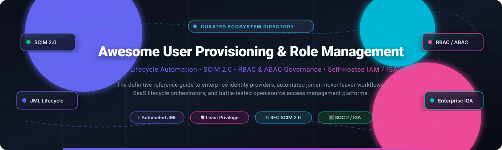
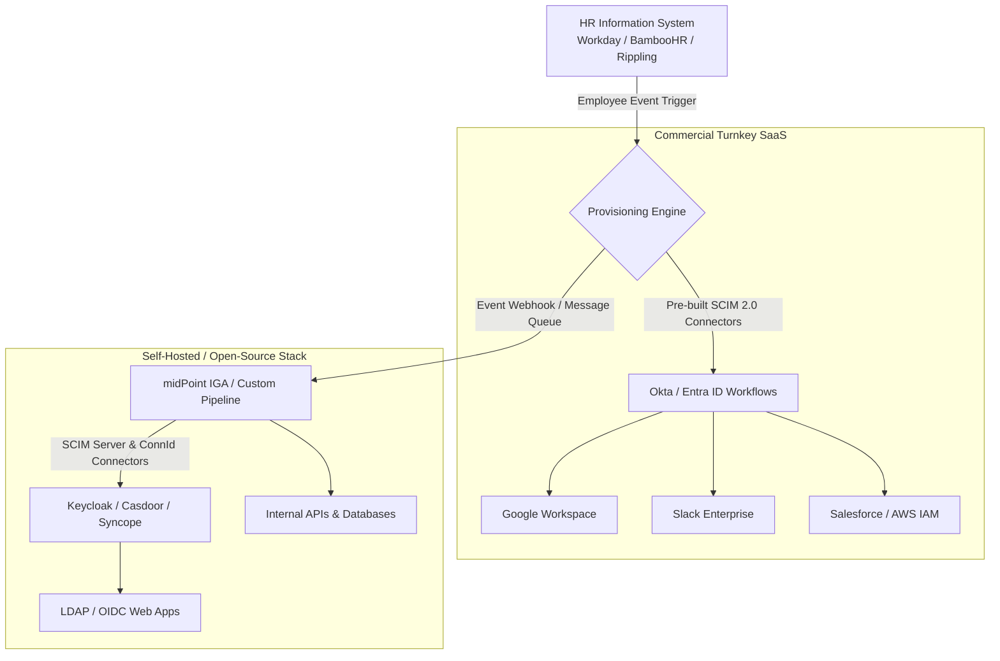

# 🔐 Awesome User Provisioning & Role Management

  <strong>Curated Directory of Identity Lifecycle Automation, SCIM 2.0 Provisioning, RBAC/ABAC Governance & Self-Hosted IAM Solutions</strong>

---

## 📑 Table of Contents
- [📌 Overview & Architecture](#-overview--architecture)
- [📊 Sector Overview & Market Dynamics](#-sector-overview--market-dynamics)
- [🏢 SaaS & Hosted Identity Platforms](#-saas--hosted-identity-platforms)
- [💻 Open-Source Identity & Governance Repositories](#-open-source-identity--governance-repositories)
- [🛠️ Architectural Patterns: Building vs. Buying](#-architectural-patterns-building-vs-buying)
- [🤝 How to Contribute](#-how-to-contribute)
- [⭐ Star History](#-star-history)
- [💖 Support & Sponsorship](#-support--sponsorship)
- [⚖️ Disclaimer & Security Advisory](#-disclaimer--security-advisory)

---

## 📌 Overview & Architecture

User Provisioning and Role Management is the critical operational layer of **Identity & Access Management (IAM)** and **Identity Governance and Administration (IGA)**. It automates the **Joiner-Mover-Leaver (JML)** lifecycle:
- 🟢 **Joiner**: Automatically provisioning accounts, directory profiles, and default role-based entitlements across cloud applications as soon as an employee is added in the HR Information System (HRIS).
- 🔄 **Mover**: Detecting department, team, or positional changes in HR records and adjusting fine-grained permissions, application licenses, and security group memberships.
- 🔴 **Leaver**: Instantly revoking SSO sessions, OAuth tokens, and provisioned user accounts across all internal and third-party SaaS services upon termination to eliminate orphaned credentials.

Modern systems rely heavily on the **RFC 7643 & RFC 7644 (SCIM 2.0 - System for Cross-domain Identity Management)** protocol to push and synchronize identity records reliably between identity providers (IdPs) and downstream service providers (SPs).

---

## 📊 Sector Overview & Market Dynamics

> 📈 **Market Size & Trajectory**: The global Identity and Access Management (IAM) and Identity Governance and Administration (IGA) sector is estimated at **$18.5 Billion in 2024** and projected to surpass **$42 Billion by 2031**, expanding at a robust compound annual growth rate (**CAGR**) of **13.5%**. Growth is propelled by hybrid work environments, SaaS sprawl, stringent regulatory compliance audits (SOC 2, ISO 27001, NIS2, HIPAA, GDPR), and zero-trust identity architectures.

> 🧩 **Market Concentration & Competitive Landscape**: The sector displays **moderate fragmentation with strong consolidation at the core identity tier**. Massive ecosystem incumbents (notably Microsoft Entra ID and Okta) maintain concentrated, near-dominant market shares for foundational enterprise Single Sign-On (SSO) and directory federation. However, specialized sectors—including fine-grained access request governance (Lumos), employee graph lifecycle automation (Rippling), privileged access management (CyberArk), and deep enterprise governance (SailPoint)—foster a highly competitive, fragmented ecosystem where modern, best-of-breed challengers actively capture emerging market segments.

---

## 🏢 SaaS & Hosted Identity Platforms

The table below lists leading commercial SaaS and hosted platforms providing identity provisioning, directory synchronization, and role governance. The table is ranked by company scale (market capitalization or latest enterprise valuation, descending).

| Company / Product 🏷️ | Market Cap / Valuation 💰 | Starting Tier Pricing 💵 | Free Tier / Free Trial Limits ⏱️ | Key Provisioning Capabilities 🎯 |
| :--- | :--- | :--- | :--- | :--- |
| **[Microsoft Entra ID](https://www.microsoft.com/en-us/security/business/microsoft-entra)** | **~$3.1 Trillion** *(Market Cap)* | **$3.00** /user/month *(Entra ID P1)*; P2 at $6.00 /user/month | **Free Forever Plan** (up to 50,000 objects/directory; supports SSO for up to 10 apps per user, basic directory sync) + **30-day Free Trial** for P2 premium features | Native Azure/M365 integration, HR-driven Lifecycle Workflows (joiner/mover/leaver), inbound/outbound SCIM 2.0 provisioning, and dynamic security group assignment. |
| **[HubSpot Account & User Management](https://www.hubspot.com/)** | **~$31 Billion** *(Market Cap)* | **$15.00** /seat/month *(Starter Tier)*; Pro tier starts at $450/month for 5 seats | **Free Forever Plan** (up to 5 users with view/edit CRM access, standard predefined permissions, no SSO/SCIM) + **14-day Free Trial** for Professional | Internal CRM seat allocation, role presets (Super Admin, Sales, Marketing, Service), team partitioning, and SAML SSO / SCIM provisioning on Enterprise tier. |
| **[CyberArk](https://www.cyberark.com/)** | **~$13.5 Billion** *(Market Cap)* | **$4.00** /user/month *(Workforce Identity SSO/MFA)*; PAM from ~$28.00 /target/month | **30-day Free Trial** (complete access to Identity Security Cloud features, up to 100 test user identities) | Privileged Access Management (PAM), zero-standing privilege enforcement, privileged account auto-discovery, and policy-driven role assignment. |
| **[Rippling](https://www.rippling.com/)** | **~$13.5 Billion** *(Valuation)* | **$8.00** /user/month *(Base platform fee plus core modules)* | **Custom Interactive Product Sandbox** (Guided trial environment with pre-populated demo data, no permanent free tier) | Unified Employee Graph; triggers automated onboarding/offboarding across 650+ SaaS tools natively based on HR hire/fire dates; zero-touch app role provisioning. |
| **[Okta](https://www.okta.com/)** | **~$12.8 Billion** *(Market Cap)* | **$2.00** /user/month *(Single Sign-On)*; Lifecycle Management starts at **$4.00** /user/month | **30-day Free Trial** (full enterprise features including Universal Directory, SCIM provisioning workflows, up to 100 users) | Cloud identity gold standard; pre-built SCIM connectors for 7,000+ cloud applications, Okta Workflows for custom business logic, and Identity Governance certifications. |
| **[SailPoint](https://www.sailpoint.com/)** | **~$6.9 Billion** *(Acquired by Thoma Bravo)* | **$5.00** /user/month *(Atlas IGA starting suite, billed annually)* | **30-day Guided POC Trial** (available for verified enterprise IT accounts with full access to Identity Security Cloud) | Enterprise Identity Governance and Administration (IGA), AI-driven role mining, segregation-of-duties (SoD) policies, and automated compliance access certification. |
| **[Ping Identity](https://www.pingidentity.com/)** | **~$2.8 Billion** *(Acquired by Thoma Bravo, merged with ForgeRock)* | **$3.00** /user/month *(PingOne Workforce Essentials)*; advanced tiers at $5.00 /user/month | **30-day Free Trial** (PingOne Cloud Platform, full workforce directory, SSO and provisioning engine for up to 50 users) | High-scale workforce federation, PingOne DaVinci orchestration canvas, inbound/outbound SCIM connectors, and continuous risk-based access evaluation. |
| **[JumpCloud](https://jumpcloud.com/)** | **~$2.6 Billion** *(Valuation)* | **$9.00** /user/month *(Core Identity package)*; Platform Plus at $18.00 /user/month | **Free Forever Plan** (Full platform features completely free for up to **10 users and 10 devices**, includes 10 days of premium 24/7 support) | Open Directory Platform unifying Mac, Windows, Linux, cloud identity, LDAP, RADIUS, and SCIM-driven SaaS app provisioning in a single pane of glass. |
| **[OneLogin](https://www.onelogin.com/)** | **~$1.5 Billion** *(Part of One Identity)* | **$4.00** /user/month *(Advanced Identity with Directory Sync)* | **30-day Free Trial** (complete access to SmartFactor Authentication, Universal Directory, and automated user provisioning) | Real-time Active Directory/LDAP bi-directional sync, rule-based role mappings, automated provisioning to popular SaaS apps, and continuous session management. |
| **[Lumos](https://www.lumos.com/)** | **~$250 Million** *(Valuation)* | **$3.50** /user/month *(App Store & Auto-Request Management)* | **14-day Free Sandbox Trial** (full Slack/Teams self-service app store, automated workflows, and entitlement review engine) | Internal self-service app store for employees, automated access request approval chains in Slack/Teams, time-bound access, and automatic deprovisioning upon role change. |

---

## 💻 Open-Source Identity & Governance Repositories

The open-source ecosystem provides modular building blocks—from full-featured OpenID Connect/OAuth2 and SCIM servers to comprehensive Identity Governance and Administration (IGA) engines. 

The repositories below are ranked by GitHub Stars_Count (descending) and feature live social badges linking to their stargazers page:

| Repository / Project 📦 | GitHub_Stars ⭐ | Primary License ⚖️ | Description & Architecture Highlights 💡 |
| :--- | :--- | :--- | :--- |
| **[Keycloak](https://github.com/keycloak/keycloak)** |  | Apache-2.0 | The de facto standard in open-source IAM backed by Red Hat. Supports OAuth 2.0, OpenID Connect, SAML 2.0, LDAP federation, fine-grained RBAC, and native SCIM 2.0 server capabilities for receiving users from Entra ID and Okta. |
| **[Authelia](https://github.com/authelia/authelia)** |  | Apache-2.0 | Lightweight authentication and authorization server acting as an identity verification companion for reverse proxies (Traefik, NGINX, Caddy). Features 2FA (TOTP, WebAuthn/FIDO2), access control lists, and OpenID Connect provider support. |
| **[Authentik](https://github.com/goauthentik/authentik)** |  | GPL-3.0 | Modern, Python/Go-powered open-source identity provider emphasizing workflow flexibility. Features built-in inbound and outbound SCIM protocol support, custom enrollment flows, user lifecycle stages, and LDAP proxy functionality. |
| **[Zitadel](https://github.com/zitadel/zitadel)** |  | Apache-2.0 | Cloud-native, event-sourced identity platform built in Go. Optimized for multi-tenancy, B2B SaaS role delegation, audit trails, and fine-grained authorization with built-in machine-to-machine (M2M) identity management. |
| **[Casdoor](https://github.com/casdoor/casdoor)** |  | Apache-2.0 | UI-first identity and access management platform supporting OAuth 2.0, OIDC, SAML, and CAS. Ships with an RFC 7643/7644 SCIM 2.0 server for synchronization, Casbin-powered RBAC/ABAC authorization, and an MCP server for AI agents. |
| **[Ory Kratos](https://github.com/ory/kratos)** |  | Apache-2.0 | API-first, headless identity and user management system written in Go. Adheres to zero-trust principles, supporting self-service registration, profile management, MFA, and pluggable identity schema validation. |
| **[Ory Keto](https://github.com/ory/keto)** |  | Apache-2.0 | Open-source implementation of Google's Zanzibar paper. High-performance, scalable relationship-based access control (ReBAC) and permission management system designed for ultra-low latency authorization checks. |
| **[WSO2 Identity Server](https://github.com/wso2/product-is)** |  | Apache-2.0 | Enterprise-grade IAM recognized as a Digital Public Good. Powers identity for over 1 billion users globally; offers comprehensive SCIM 2.0 inbound/outbound provisioning, adaptive authentication, and fine-grained RBAC administration. |
| **[midPoint (Evolveum)](https://github.com/Evolveum/midpoint)** |  | Apache-2.0 | The preeminent open-source Identity Governance and Administration (IGA) platform. Provides comprehensive provisioning connectors, organizational hierarchy role modeling, automated lifecycle events, access reviews, and audit trails. |
| **[Apache Syncope](https://github.com/apache/syncope)** |  | Apache-2.0 | Top-level Apache project dedicated to digital identity management and enterprise provisioning. Features bi-directional identity reconciliation, ConnId connector architecture, end-user self-service, and role entitlement synchronization. |
| **[GoSCIM](https://github.com/arturoeanton/goscim)** |  | Apache-2.0 | Ultra-fast, lightweight SCIM 2.0 server implemented in Go. Features dynamic schema loading via JSON, fine-grained attribute-level permissioning, ETag concurrency controls, and high-throughput Couchbase storage integration. |
| **[hr-onboarding-automation](https://github.com/suresh-1001/hr-onboarding-automation)** |  | MIT | Reference orchestration pipeline wiring HRIS (BambooHR/HiBob) to Google Workspace, Microsoft Entra ID, Slack, and Jira using declarative YAML role definitions, least-privilege policies, and cryptographically verifiable audit logs. |
| **[Hanzo IAM](https://github.com/hanzoai/iam)** |  | Apache-2.0 | AI-first identity and access management system with WebAuthn, OAuth 2.1, SCIM provisioning endpoints, and specialized Agent-to-Agent (A2A) Model Context Protocol (MCP) identity gateway capabilities. |

---

## 🛠️ Architectural Patterns: Building vs. Buying

When designing user provisioning and role management architectures, engineering teams encounter distinct tradeoffs across implementation paradigms:

### 1. The Core Ingestion Tier (Identity Provider)
- **Keycloak**, **Casdoor**, or **Authentik** act as the identity broker and SCIM ingestion point. They ingest user objects and enforce authentication (SSO/MFA) and coarse-grained role assignment.

### 2. The Governance Tier (IGA)
- **midPoint** and **Apache Syncope** provide the complex role synchronization, entitlement reconciliations, segregation-of-duties (SoD), and access certification required by enterprise auditors.

### 3. The Connector Ecosystem Gap
- **Commercial SaaS advantages**: Solutions like Okta, Entra ID, and Rippling invest thousands of engineering hours maintaining pre-built API connectors to thousands of third-party SaaS vendors.
- **Open-source strategy**: Teams utilizing open-source tools typically deploy **midPoint connectors (ConnId)** or custom Python/Go automation scripts (patterned after `hr-onboarding-automation`) to push changes across heterogeneous endpoints.

---

## 🤝 How to Contribute

We welcome additions, corrections, and improvements from identity security practitioners, IT architects, and open-source contributors!

1. 🍴 **Fork the repository** to your GitHub account.
2. 🌿 **Create a descriptive feature branch**: `git checkout -b add-identity-tool`.
3. 📝 **Add or update the platform**:
   - For SaaS: Ensure you specify starting tier pricing, free plan / trial details, and company valuation/revenue metrics.
   - For Open-Source: Ensure you provide the official repo link, accurate license, and verified GitHub Stars_Badge.
4. 🚀 **Submit a Pull Request (PR)** with a clear rationale and links to official documentation or pricing pages.

---

## ⭐ Star History

---

## 💖 Support & Sponsorship

Thank you for exploring this curated repository! If you find this resource helpful for your architecture designs, IAM engineering, or compliance workflows, please consider showing your support:

- ⭐ **Star the repository** to boost visibility for the community.
- 🍴 **Fork and share** with fellow security engineers and IT architects.
- ☕ **Buy a coffee / Sponsor**: If you'd like to support continued maintenance and curation of open security resources, consider sponsoring on GitHub:
  
  

---

## ⚖️ Disclaimer & Security Advisory

- This curated list is maintained for educational, architectural, and informational purposes. Mention does not constitute commercial endorsement.
- **Security Warning**: Incomplete deprovisioning workflows and orphaned access tokens represent one of the leading vectors for identity-based enterprise compromises. Always implement robust joiner-mover-leaver verification and automated access reconciliation.
- All trademarks, logos, and brand names belong to their respective corporate owners.

---

  Maintained with ❤️ for Identity Architects, CISOs, DevOps Engineers, and IT Administrators worldwide.

